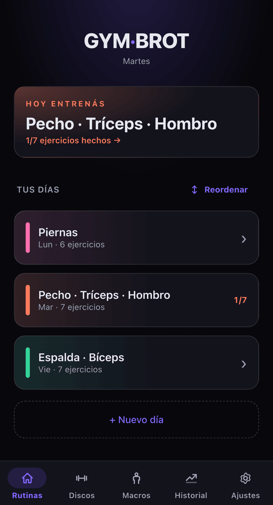
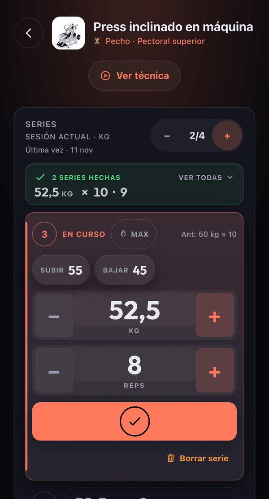
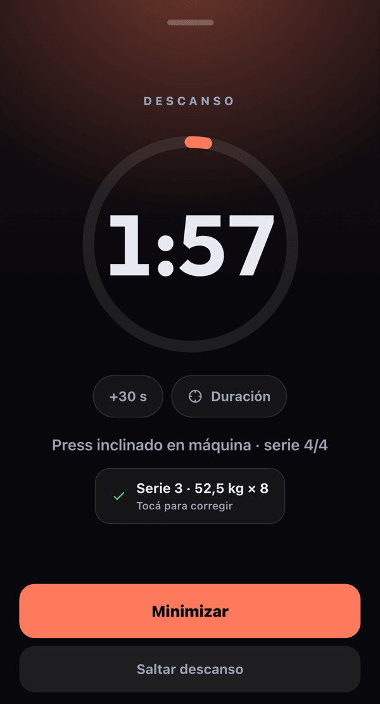
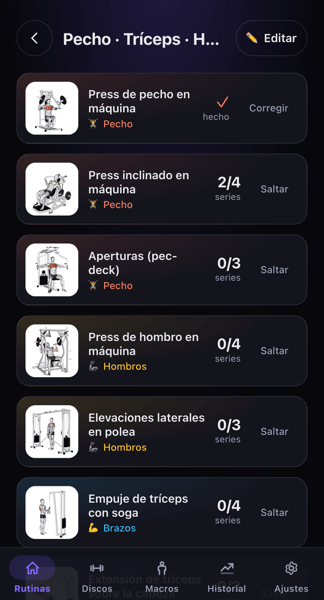
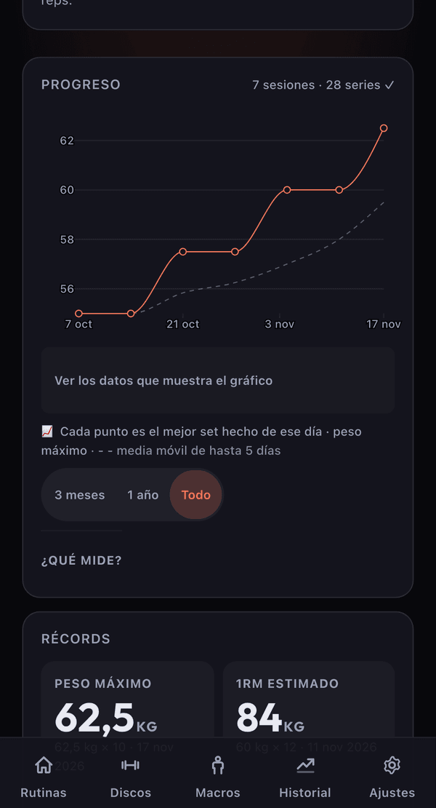
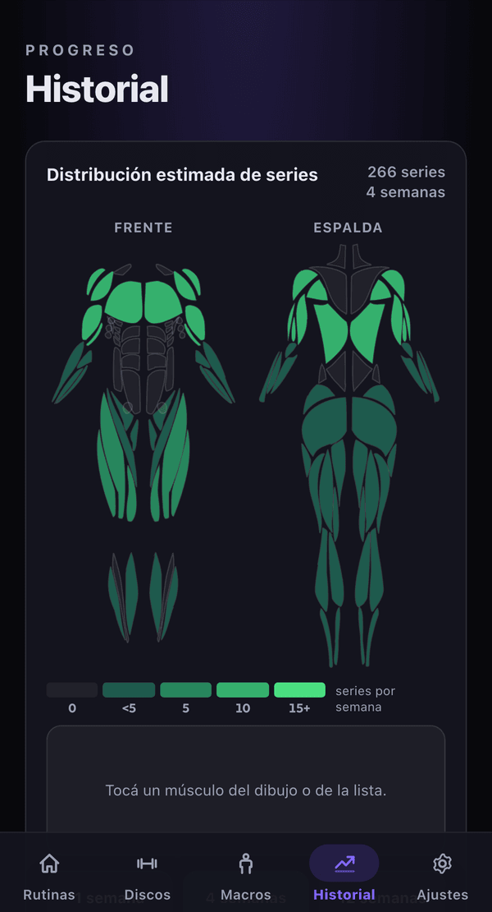

# Gym-brot

**Registrá cada serie con una mano, entre repetición y repetición, sin señal y sin cuenta.**

Gym-brot es una app de gimnasio para el celular: armás tus días de rutina, cargás peso × reps
con dos toques y la app te avisa cuándo terminó el descanso y cuándo hiciste un récord.
Funciona sin internet y tus datos no salen del teléfono.

Es una app personal: el código está publicado para mostrar cómo está hecha, no hay una versión
abierta al público para instalar.

<table>
  <tr>
    <td align="center"><br><sub>Qué toca hoy</sub></td>
    <td align="center"><br><sub>La serie en curso, grande</sub></td>
    <td align="center"><br><sub>Descanso a pantalla completa</sub></td>
  </tr>
  <tr>
    <td align="center"><br><sub>Tu día, ejercicio por ejercicio</sub></td>
    <td align="center"><br><sub>Progreso y récords por ejercicio</sub></td>
    <td align="center"><br><sub>Qué músculos trabajaste</sub></td>
  </tr>
</table>

<sub>Capturas reales de la app con un mes y medio de entrenamiento de ejemplo.</sub>

## Qué hace

- **Registro en dos toques.** La serie que estás haciendo aparece entera y con la carga de la
  última vez ya puesta; las hechas se resumen arriba. Botones grandes, pensados para usar con una
  mano y con los dedos transpirados.
- **Descanso que no se pierde.** El temporizador sigue aunque bloquees el teléfono o cambies de
  app, y la pantalla no se apaga mientras entrenás.
- **Récords honestos.** Cuando hacés un PR la app lo celebra y te dice qué midió: peso máximo o
  1RM estimado, a elección por ejercicio.
- **Progreso de verdad.** Gráfico por ejercicio, historial de cada sesión, mapa corporal de series
  por músculo, peso corporal y objetivo de calorías.
- **962 ejercicios con video** de la técnica, con buscador y filtro por grupo muscular.
- **Sin internet.** Todo funciona offline desde que la instalás; los videos se pueden bajar para
  un gimnasio sin señal desde _Ajustes → Descargar todos los videos_ (~20 MB).
- **Tus datos son tuyos.** No hay cuentas ni servidor: todo queda en el teléfono y se puede
  exportar a un archivo cuando quieras.

## En el celular

Se instala desde el navegador como una app más (Android: _Instalar app_; iPhone: _Compartir →
Agregar a inicio_), sin tienda, registro ni publicidad. Arranca con tres rutinas de ejemplo
editables.

Cuando hay una versión nueva, la app avisa y espera: nunca se actualiza sola en medio de un
ejercicio o de un descanso.

## Tus datos y el backup

Todo se guarda en el navegador del teléfono. Desde **Ajustes** podés exportar un archivo con tus
rutinas, sesiones, ajustes y peso corporal, y restaurarlo en otro dispositivo. Cada teléfono es su
propio perfil: no hay sincronización.

> **En iPhone hacé backup seguido.** iOS puede borrar los datos de una app web que no abrís por
> varias semanas.

## Cómo está hecha

Una PWA estática, sin backend: **SvelteKit + Svelte 5** (runes), **Tailwind v4**, **Dexie.js**
sobre IndexedDB y **vite-pwa** para el modo offline.

- Tests unitarios con Vitest y end-to-end con Playwright en un teléfono emulado, en CI en cada
  push.
- El build falla si el shell pasa su presupuesto de peso o si el service worker deja de cubrir
  la app sin conexión.
- CSP estricta y sin orígenes externos salvo el reproductor de YouTube de "Ver técnica".

Para correrla en local hace falta **Node 22.12 o más nuevo**:

```bash
npm install
npm run dev          # http://localhost:5173
npm run check        # tipos
npm test             # unitarios + cobertura
npm run test:e2e     # build + Playwright
```

Las capturas de este README se regeneran con datos de ejemplo:

```bash
npm run build && npx playwright test -c scripts/capturas/playwright.config.ts
```

## Licencia

El código es **propietario, con todos los derechos reservados** (ver [`LICENSE`](LICENSE)):
está publicado para que se pueda leer, no para copiarlo ni redistribuirlo.

Las animaciones de ejercicios provienen de GIFs de ExerciseDB convertidos a MP4 y tienen
autorización de uso desde el 2026-08-25. La metadata de ejercicios y la geometría del mapa
corporal son MIT y conservan su aviso en [`THIRD_PARTY_NOTICES.md`](THIRD_PARTY_NOTICES.md). El
inventario del catálogo y los MP4 está en [`docs/auditoria-assets.md`](docs/auditoria-assets.md).
